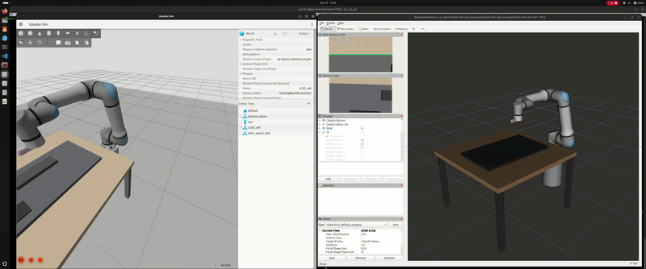

# UR30 workcell simulation (ROS 2 Jazzy + Gazebo)

A simulated robot workcell for developing vision-guided manipulation, with the
aim of eventually running the same code on a real UR30 with an Orbbec Gemini
335Lg camera on a Jetson Orin AGX.

The cell contains:

- a **UR30** arm on a cylindrical pedestal at the world origin,
- a **table** (1.2 x 1.2 m, top at z = 0.75 m) in front of the robot,
- an **automotive door panel** (0.9 x 0.55 x 0.03 m, with armrest, speaker grille
  and four corner clamps) fixtured on the table,
- an **Orbbec Gemini 335Lg** mounted eye-in-hand on the tool flange, streaming
  into Gazebo and RViz.

The panel and table are simple primitives. No external meshes are needed except
the UR and Orbbec ones.

On top of the cell sits the visual servoing work: ViSP image-based visual servoing (IBVS)
that finds the panel, follows its edge, and can dispense a lap around its boundary while the
part is nudged at random. See [Visual servoing](#visual-servoing).

## Repository layout

| Path | What it is |
|---|---|
| `ur30_cell_description/` | The cell's xacro: pedestal, table, door panel, camera mount, and `ur30_cell.xacro` that assembles them. |
| `ur30_cell_bringup/` | Launch file, RViz config, Gazebo world and camera bridge config. |
| `ur30_cell_moveit_config/` | MoveIt Servo setup (SRDF, kinematics, joint limits, Servo parameters, launch) used to send Cartesian twists to the arm. No `move_group`. |
| `ur30_ibvs/` | The IBVS package: panel detector, edge tracker, controller, state machine, dispense lap, part shifter and tests. Has its own [README](ur30_ibvs/README.md). |
| `ur_description_gz/` | Vendored `Universal_Robots_ROS2_Description` (ROS package name `ur_description`). |
| `ur_simulation_gz/` | Vendored `Universal_Robots_ROS2_GZ_Simulation`. |
| `orbbec_description/` | Vendored `orbbec_description` from `OrbbecSDK_ROS2` (URDF and meshes only). |

The three vendored directories are recorded in this repository as git links
(gitlinks) **without a `.gitmodules` file**, so `git clone` leaves them empty and
`git submodule update --init` does nothing. You have to fetch them yourself, see
the next section.

## Setup

Requirements: Ubuntu 24.04, ROS 2 Jazzy, Gazebo Harmonic (the Jazzy default).

### 1. Clone into a workspace

```bash
mkdir -p ~/ur_ws_ah && cd ~/ur_ws_ah
git clone https://github.com/pvrohin/UR30_ROS2_IBVS.git src
cd src
```

### 2. Fetch the three vendored repositories

These are the exact revisions the cell was built and tested against.

```bash
# UR robot description (branch jazzy)
git clone --branch jazzy https://github.com/UniversalRobots/Universal_Robots_ROS2_Description.git ur_description_gz
git -C ur_description_gz checkout 3924298

# UR Gazebo simulation (branch ros2)
git clone --branch ros2 https://github.com/UniversalRobots/Universal_Robots_ROS2_GZ_Simulation.git ur_simulation_gz
git -C ur_simulation_gz checkout 5f0161a

# Orbbec description only (sparse checkout, the full repo is large)
git clone --filter=blob:none --no-checkout --branch v2-main https://github.com/orbbec/OrbbecSDK_ROS2.git orbbec_description
git -C orbbec_description sparse-checkout init --cone
git -C orbbec_description sparse-checkout set orbbec_description
git -C orbbec_description checkout 8e7cad2
```

Check: `ls orbbec_description/orbbec_description` should show `launch`, `meshes`,
`package.xml` and so on. `git status` in `src/` should stay clean.

### 3. Install dependencies

```bash
sudo apt update
sudo apt install \
  ros-jazzy-ros-gz-sim ros-jazzy-ros-gz-bridge ros-jazzy-gz-ros2-control \
  ros-jazzy-ros2-control ros-jazzy-ros2-controllers \
  ros-jazzy-joint-state-broadcaster ros-jazzy-joint-trajectory-controller \
  ros-jazzy-robot-state-publisher ros-jazzy-xacro ros-jazzy-rviz2 \
  ros-jazzy-moveit-servo ros-jazzy-visp
cd ~/ur_ws_ah
source /opt/ros/jazzy/setup.bash
rosdep install --from-paths src --ignore-src -r -y   # picks up anything missing
```

### 4. Build

```bash
cd ~/ur_ws_ah
colcon build --symlink-install --allow-overriding ur_description
source install/setup.bash
```

`--allow-overriding ur_description` is needed because a system-installed
`ros-jazzy-ur-description` may exist next to the vendored copy, which has the
same package name. The workspace copy must win.

## Run

```bash
ros2 launch ur30_cell_bringup ur30_cell.launch.py
```

This starts Gazebo with the cell, `robot_state_publisher`, the ros2_control
controllers (`joint_state_broadcaster`, then `joint_trajectory_controller`), the
camera bridge and RViz. RViz shows the robot model, TF and the camera images.

To run only the cell without the vision packages, build with `--packages-up-to ur30_cell_bringup`.

## Geometry (world frame)

| Item | Pose |
|---|---|
| Pedestal | height 0.5 m, radius 0.15 m, at the origin |
| Robot base | (0, 0, 0.5) |
| Table top centre | (0.9, 0, 0.75) |
| Door panel centre | (0.8, 0, 0.79), top face at z = 0.805 |

## Known problems

- Depth and point cloud are not bridged by default (they cost a lot of CPU at 30 Hz and the
  IBVS pipeline does not use them). Pass `bridge_depth:=true` to `ur30_cell.launch.py` to enable them.
- The vendored repositories are not set up as real submodules (see above).
- Only verified in headless Gazebo. The Gazebo and RViz GUIs were only partly exercised, and real
  hardware has **not** been tested.

## Visual servoing



[ViSP](https://github.com/lagadic/visp) IBVS lives in two packages:

- `ur30_ibvs`: a C++ node that surveys the table, detects the door panel, approaches it, then
  tracks one long edge with ViSP (`vpMeLine`, `vpServo`) at 0.2 m standoff. With
  `dispense_enabled` it goes on to trace the whole panel boundary (the "dispense lap"), turning
  each corner by rotating the camera image, and a `part_shifter` node moves the part by up to
  2 cm / 2 deg at random during the lap to show lateral tracking. It has unit tests and a debug
  image topic. Details, parameters and results are in [`ur30_ibvs/README.md`](ur30_ibvs/README.md).
- `ur30_cell_moveit_config`: the MoveIt Servo configuration used to turn twists into joint
  velocities for `forward_velocity_controller`.

```bash
colcon build --symlink-install --allow-overriding ur_description
source install/setup.bash

# hold 0.2 m above the +y edge of the panel
ros2 launch ur30_ibvs ur30_ibvs.launch.py

# dispense lap with random part nudges
ros2 launch ur30_ibvs ur30_ibvs.launch.py demo:=true

# clean lap, no nudges
ros2 launch ur30_ibvs ur30_ibvs.launch.py demo:=true shifts:=false

# headless
ros2 launch ur30_ibvs ur30_ibvs.launch.py demo:=true gazebo_gui:=false launch_rviz:=false
```

Tests: `colcon test --packages-select ur30_ibvs` (92 tests).

Status: in headless Gazebo the panel is found at its true pose, the camera settles within about
1 mm of the target when holding, and the dispense lap closes with a settled boundary error of
about 3-7 mm under nudges (see `ur30_ibvs/README.md`).

## License

The repository contains a `LICENSE` file with the GPLv3 text, but the packages
`ur30_cell_description` and `ur30_cell_bringup` declare `BSD-3-Clause` in their
`package.xml`. This mismatch is unresolved; decide on one before distributing.
The vendored repositories keep their own licenses (Universal Robots: BSD-3-Clause,
OrbbecSDK_ROS2: Apache-2.0).
